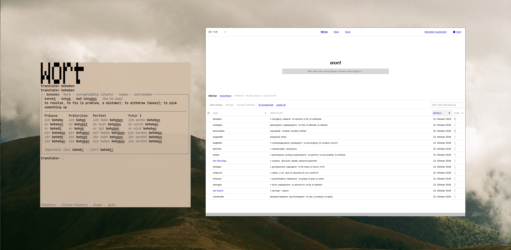

# wort



Self-hosted tool for learning German (EN↔DE), local first, on Wiktionary data: a CLI tool for your own machine and a web view for a home server.

**Status: work in progress.**

## Two parts

The project has two front ends that share one dictionary and its lookup and grammar code (`src/wort/dictionary/`):

| | **CLI tool** (`wort`) | **Web view** (`app/`) |
|---|---|---|
| What | Terminal lookup and session, history, export | Browser app: word list with scores, word detail, practice |
| Where it runs | Your own machine, offline (except `wort sync`) | A small home server (e.g. a Raspberry Pi), reachable on the LAN / VPN only |
| Users | One (you) | Several, invite-only accounts |
| Code | `src/wort/` | `app/` (FastAPI + Jinja2, UI only from the `dis-system` submodule) |
| Data | `user.db` | `web.db` |

They are connected one way only: words and history go from the CLI to the web view, by
`wort export` → import on the word list page, or by `wort sync` (one HTTPS endpoint, write-only token).
Practice scores are kept separately in each part.

## CLI tool

### Works now

- **Translation (DE → EN).** `wort WORD` returns a compact card: principal forms, translation, IPA, grammar table, up to 10 example sentences.
  - Verbs: Präsens / Präteritum / Perfekt / Futur I, Imperativ.
  - Nouns: 4 cases, singular and plural.
  - Adjectives: comparison degrees.
  - Inflected forms are found too (`ging` → `gehen`).
- **Interactive session.** `wort` opens a prompt: type words or phrases, `/history` shows everything you ever looked up as a bullet list (no duplicates, kept between runs), `/clear-history` deletes it after a confirmation, `clear` wipes the screen, `quit` leaves.
- **Pinned banner and commands.** The WORT banner stays fixed at the top of the terminal and the command list (`/history . /clear-history . clear . quit`) on its last row, while the session scrolls between them. Both follow window resizes. While nothing is on screen, this session's last five words appear as bullets under the banner. Windows under 15 rows get nothing pinned.
- **Several results.** In the session they show as a numbered compact list (forms and translations only). `j`/`k` move, a digit, `l` or Enter opens the full card, `h` goes back, `q`/Esc closes. In an open card `j`/`k` scroll and space/`b` page when it is taller than the screen. Without a terminal everything is printed in full.
- **Phrases.** Several words (up to five, e.g. `warten auf dem`) are looked up as a whole first, otherwise word by word: one result per word in the numbered list, typos corrected per word. The history keeps what you typed.
- **Typos.** When nothing is found, close matches (one or two letters off, a swap counts as one) are offered in the same numbered list under `Did you mean:`. The history keeps what you typed.
- **Query history.** Every lookup is logged automatically to `user.db`.
- **Export.** `wort export` writes history and practice words to JSON (for the future web app).

### Prototype, not finished

Exist in the code (`wort tui`, `wort add`, `wort list`) but are not part of the supported feature set yet:

- Practice exercises (translation, article, forms, multiple choice, sentence)
- SM-2 spaced repetition and mastery scores
- Full-screen TUI (Textual)

### Planned

- **Word memorization**
  - Per-word score and per-skill sub-scores
  - Review scheduling (SM-2)
  - Reliable practice sessions with graded answers
- **Exercises**
  - Translation, article, correct case/form
  - Grammar multiple choice
  - Sentence writing with local LanguageTool check
- Details: [`PLAN.md`](PLAN.md), rules: [`CLAUDE.md`](CLAUDE.md), decisions: [`DECISIONS.md`](DECISIONS.md)

### Installation

Requires Python ≥ 3.11 and [uv](https://docs.astral.sh/uv/).

```bash
git clone <repo> && cd wort
uv sync
python scripts/fetch_data.py dictionary downloads/   # once, separate from the CLI: ~1 GB JSONL from kaikki.org
uv run wort import --file downloads/kaikki.org-dictionary-German.jsonl   # → dictionary.db
uv run wort gehen                 # look one word up
```

Global install: `uv tool install .`

### Commands

| Command | What it does |
|---|---|
| `wort` | interactive session |
| `wort WORD` | look one word up; exit code 1 if not found |
| `wort t WORD` | explicit lookup for words that are also commands (`list`, `add`, …) |
| `wort history [--limit N]` | queries you typed |
| `wort export [FILE]` | history + practice words as JSON |
| `wort import --file F` | (re)import the dictionary from a kaikki.org JSONL (the CLI never downloads) |
| `wort sync` | push words and history to the web app (the only network use; see DEPLOY.md §3b, §7) |
| `wort add WORD [--pos verb]` | *(prototype)* add to practice list |
| `wort list` | *(prototype)* mastery of practice words |
| `wort tui` | *(prototype)* full-screen interface |

### Data and privacy

- Data lives in `~/.local/share/wort/` (or `$XDG_DATA_HOME/wort`, or `$WORT_HOME`): `dictionary.db` (read-only), `user.db` (history, words, SRS state).
- The only network use is `wort sync` (one HTTPS endpoint, write-only token); downloads live in `scripts/fetch_data.py`. No API keys, no cloud services. Run it through `scripts/wort-offline` to cut the network at the OS level.
- Optional LanguageTool client accepts loopback addresses only (`WORT_LT_URL`; remote needs `WORT_LT_ALLOW_REMOTE=1`).

## Web view

FastAPI + Jinja2, SQLite, vanilla JS. The UI is built only from [`dis-system`](https://github.com/dsgnrfhmn/dis-system),
vendored as a git submodule.

### Works now

- Login: invite-only accounts (argon2 passwords, no signup), sessions with HttpOnly / SameSite=Strict / Secure cookies, CSRF on every form.
- **Wörter**: per-user word list with scores, search, sorting, presets (weakest, latest), word detail with forms, examples and your mistakes, your own translation.
- **Üben**: practice sessions on selected words: *Sätze bilden* (write sentences) and *Abfrage* (quiz), graded locally; results change the word scores.
- Lookup on the Wörter page: a word or a sentence → forms, translation, examples; every search goes to the history (Verlauf), "Zu Wörtern hinzufügen" adds a result to the word list, "Lernen" adds one from the history.
- Word tooltips everywhere: resting the pointer on any German word (tables, word detail, examples, practice) shows its lemma, Ukrainian and English (`GET /api/gloss`); German button labels have their own fixed translations (`app/ui_terms.py`).
- Import of the CLI export, and `wort sync` from the CLI.
- AI feedback (Haiku, backend only) exists but is off until a key is installed: `DECISIONS.md` D0r, `DEPLOY.md` §6.

See [Roadmap](#roadmap) below.

### Run it locally

```bash
git clone --recurse-submodules <repo> && cd wort     # the UI needs the dis-system submodule
uv sync --group web
uv run wort import --file tests/fixtures/german_sample.jsonl   # 10-word test dictionary; or the full one, see CLI installation
PYTHONPATH=.:src uv run python scripts/adduser.py NAME          # no signup: create a user (password min. 12 characters)
WORT_INSECURE_COOKIES=1 PYTHONPATH=.:src uv run uvicorn app.main:create_app --factory --port 8000
```

Open <http://127.0.0.1:8000> and sign in. In this plain-http mode the app answers only `127.0.0.1` / `::1`.
For other devices on the LAN use `scripts/dev.sh` (https, see its header); for the server use `DEPLOY.md`
(podman compose, nginx with TLS on the LAN address).

## Roadmap

What we still want to build, by area. Order and Definition of done per step: [`PLAN.md`](PLAN.md); screens: the
design canvas (Wörter, Üben, Texte).

### UX improvements

- Word tooltips with translations in the practice feedback (lemma, translation, grammar note per marked word).
- Word detail: mistakes marked in the declension table, the matching rule shown with the answer highlighted.
- "Fehler erklärt" as a side pane beside the exercise, with the rule table (canvas Üben 4).
- Keyboard: row selection with Space/Enter, visible focus everywhere.
- CLI: less text per screen (shorter cards, examples on demand).
- Both themes checked on every state of every screen, not only the main ones.

### Modules per block

| Block | Module | Status |
|---|---|---|
| Wörter | word list, detail, lookup (`app/words.py`, `app/lookup.py`) | works |
| Wörter | per-word tooltips (`app/tokens.py`: tokenize, lemma, translation per word) | planned |
| Üben | practice sessions, local grading (`app/practice.py`, `app/checking.py`, `app/scoring.py`) | works |
| Üben | AI feedback (`app/ai/`) | built, off until a key is installed |
| Üben | review queue and scheduling | planned |
| Texte | upload validation (`app/uploads.py`: size cap, MIME + magic bytes, image deleted after OCR) | planned |
| Texte | local OCR (`app/ocr.py`, Tesseract `deu`, uncertain spots) | planned |
| Texte | saved texts and notes (`app/texts.py`) | planned |
| Dictionary | Step 0 measurements: coverage and lemmatizer (`spikes/`) | planned |
| Server | sandbox proofs for the podman compose deploy (D00f): other services' files unreadable, egress only to the AI host | planned |
| Server | nightly SQLite backup with a tested restore, logs, admin usage view | planned |
| UI | new dis-system components (word token, dropzone, stepper, correction row, image regions, note item, progress bar) | on a dis-system branch, PR to its `main` pending |

### Mobile version

The design canvas has desktop screens only (1920 px). For phones:

- Phone layouts (390 px) on the canvas first for Wörter, Üben and Texte, then built from dis-system.
- Split views stack: the open word or the explanation pane comes above the table, not beside it.
- Tables keep readable columns and scroll sideways in their own box; nav and header bars wrap.
- Touch instead of hover: word cards and tooltips open on tap, close on a second tap or outside.
- Üben: the answer field stays pinned at the bottom above the keyboard.
- Texte: take a photo with the phone camera directly from the upload step.
- Touch targets at least 44 px; both themes checked at phone width.

## Development

```bash
uv sync --group web                  # web tests need the web dependencies; AI tests also need --group ai (they skip otherwise)
PYTHONPATH=.:src uv run pytest
```

```
src/wort/                # CLI tool
  cli.py                 # commands, interactive session
  transfer.py            # export format
  dictionary/            # importer, lookup, grammar form selection
  render/card.py         # word card (Rich)
  store.py, srs.py       # user.db, SM-2
  exercises/             # prototype exercises
  tui/                   # Textual interface
  sanitize.py            # input/output sanitizers, used by both parts
app/                     # web view
  main.py                # routes, login, CSRF
  auth.py, db.py         # accounts, web.db
  words.py, practice.py  # word list, practice sessions
  scoring.py             # score formula
  ai/                    # AI layer (off by default)
  templates/, static/    # Jinja2 pages, layout-only CSS
vendor/dis-system/       # design system (git submodule)
tests/fixtures/german_sample.jsonl
```

Dictionary data: [Wiktionary](https://en.wiktionary.org) (CC BY-SA) via [kaikki.org / wiktextract](https://kaikki.org).

Session state and next steps: `HANDOFF.md`.
